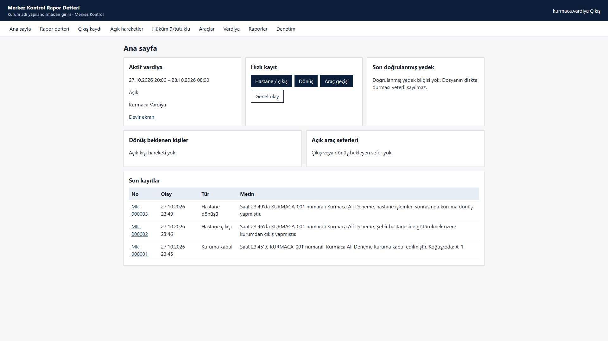
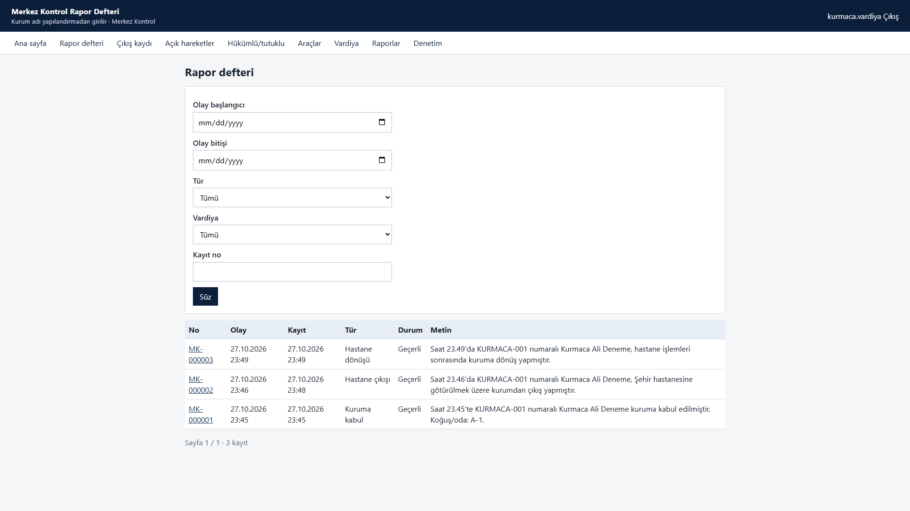
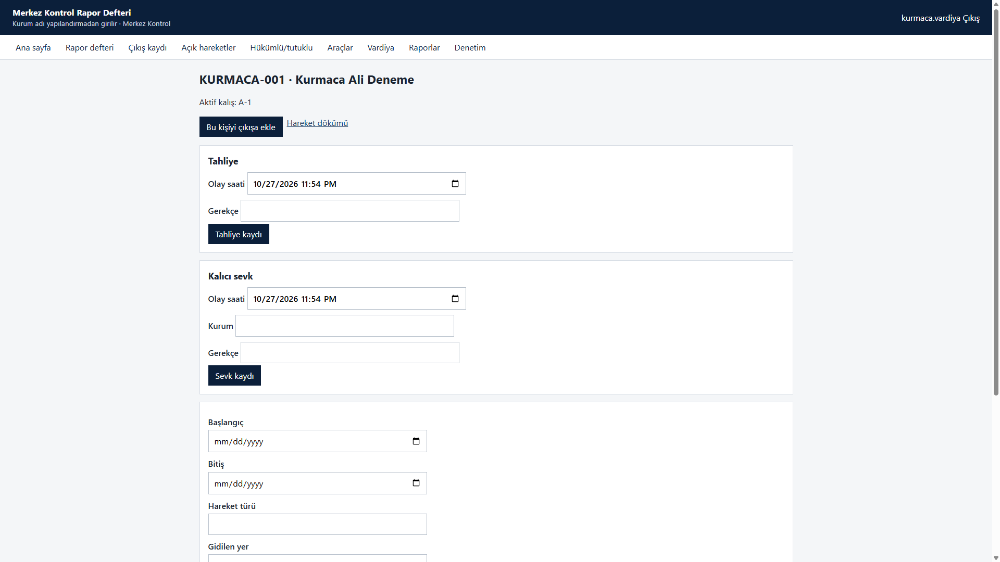
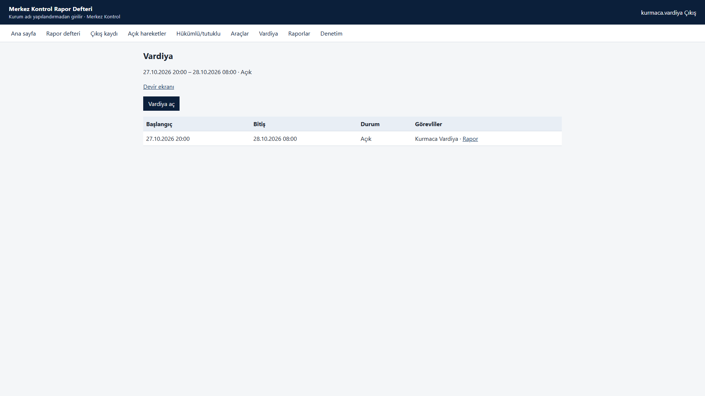
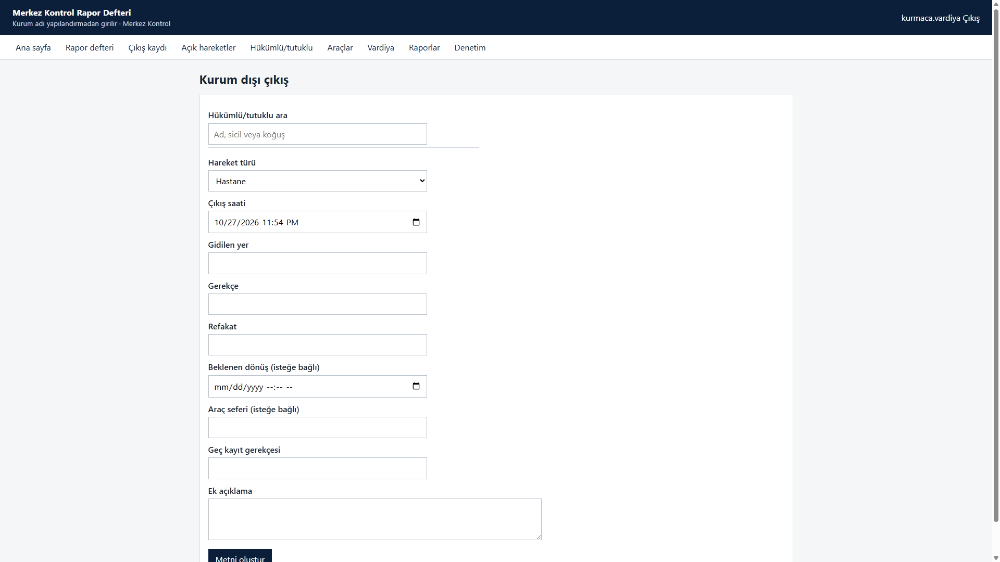
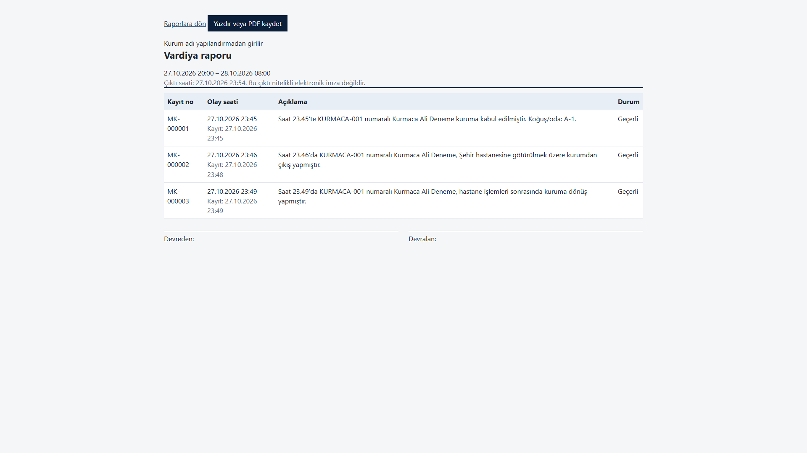

# Merkez Kontrol Rapor Defteri

Ceza infaz kurumunda elle tutulan günlük merkez kontrol rapor defterinin kayıt, arama, hareket takibi ve vardiya raporlamasını kurum içi kapalı ağda çalışacak şekilde dijitalleştiren uygulama.

Bu sürüm kayıt ve raporlama aracıdır. Resmî defterin yerine geçmez, nitelikli elektronik imza üretmez ve başka kurumsal sistemlerle entegre olmaz.

Ekran görüntüleri kurmaca veriyle alınmıştır. Gerçek kişi veya kurum adı yoktur.

## Ekranlar

Ana sayfa aktif vardiyayı, dönüş bekleyen kişileri, açık araç seferlerini ve son kayıtları gösterir.



Rapor defteri kayıtları olay saati ve sisteme yazılma saati ayrı olacak şekilde listeler.



Hükümlü/tutuklu kartında kabul, hastane çıkışı ve dönüş aynı kişiye bağlı kronolojik geçmiş olarak durur. Ad soyad tekil değildir; sicil numarası kaydı ayırır.



Vardiya gece yarısını aşabilir. Başlangıç ve bitiş ayrı tarih-saat olarak tutulur.



Kurum dışı çıkışta metin, kayıttan önce şablonla üretilir. Kullanıcı metni serbestçe değiştirmez; ek açıklama ayrı alandadır.



Vardiya raporu tarayıcıdan yazdırılır veya PDF olarak kaydedilir. Ayrı bir PDF kütüphanesi yoktur.



## Çalışma biçimi

- Uygulama ve PostgreSQL kurum içindeki bir sunucuda durur.
- Kullanıcılar yerel ağdan tarayıcıyla bağlanır. Tek bilgisayarda `localhost` yeterlidir.
- Çalışma anında internet, CDN, harici yazı tipi veya çevrimiçi kimlik doğrulama gerekmez.
- Sunucu veya veritabanı erişilemezse kayıt başarılı gösterilmez.

## Teknoloji

| Katman | Seçim |
| --- | --- |
| Çalışma zamanı | .NET 10 LTS (`net10.0`, SDK 10.0.403) |
| Web | ASP.NET Core MVC, çerez kimlik doğrulama |
| Veri | Entity Framework Core, PostgreSQL |
| Arayüz | Uygulamayla dağıtılan yerel CSS ve JavaScript |

Katmanlar `Domain`, `Application`, `Infrastructure`, `Web` ve `Tests` projeleridir. Domain katmanı EF Core’a bağlanmaz.

Ayrıntılı kararlar `docs/` altındadır. Kurulum, hesaplar, yedekleme ve geri dönüş `docs/08-kurulum-ve-yedekleme.md` içindedir.

## Geliştirme

Geliştirme makinesinde paket indirmek serbesttir. Kurum sunucusu yayınlanmış çıktıyı çevrimdışı çalıştırır.

```powershell
$env:DOTNET_CLI_TELEMETRY_OPTOUT = "1"
$env:DOTNET_ROOT = "$env:LOCALAPPDATA\Microsoft\dotnet"
$env:PATH = "$env:DOTNET_ROOT;$env:PATH"
dotnet test RaporDefteri.slnx
dotnet run --project src/RaporDefteri.Web
```

Geliştirme veritabanı, makinede zaten çalışan PostgreSQL hizmetine dokunmadan `scripts/dev/init-postgres.ps1` ile `127.0.0.1:5433` üzerinde açılır. Parolalar depoya yazılmaz. Şema uygulama açılışında kendiliğinden kurulmaz; migration migrator hesabıyla uygulanır.

İlk kullanıcı `/kurulum` ekranından oluşturulur. Kaynak kodda sabit yönetici parolası yoktur. Demo kişiler yalnızca Development ortamında ve `--demo` argümanıyla yüklenir.
